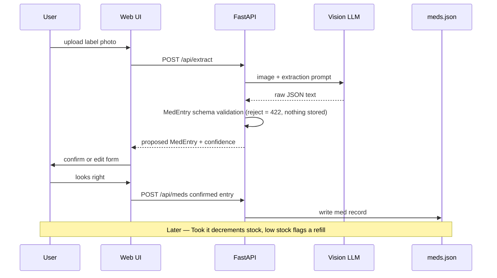

# Level 1 — The extraction harness

## What's new

Photo of a prescription label → LLM → validated `MedEntry` JSON → human
confirm → `meds.json`. Stock decrements on "Took it"; low stock (< 7 days
of doses) and "dose due" flags render in the UI.

The entire AI surface is one function: `extract_med(image_bytes) -> MedEntry`
in `app/llm.py`. Everything around it is normal FastAPI + vanilla JS.

## How it flows

## What I learned

1. **Structured output isn't prompt-and-pray.** The prompt asks for JSON,
   but the guarantee comes from the other side: whatever the model returns
   gets parsed through the `MedEntry` Pydantic schema before it can touch
   storage. Bad output → 422, never a corrupt record.
2. **The schema is the contract.** One `MedEntry` model serves both as the
   extraction target and the storage record — no translation layer where
   bugs hide.
3. **Human-in-the-loop is part of the harness.** The confirm form isn't a
   UX nicety; it's the verification step that makes an unreliable OCR step
   safe to put in front of medication data.
4. **`confidence` as a designed output.** The model must *say* how sure it
   is. Low confidence + confirm screen = graceful degradation instead of
   silent wrong answers.
5. **Evals before iteration.** `evals/run_eval.py` scores per-field
   accuracy over a photo/expected pair set. Without it, "improving the
   prompt" is superstition — you can't tell a fix from a regression.
6. **Provider-agnostic costs little.** `LLM_PROVIDER` selects anthropic /
   openai / mock behind one signature. The `mock` provider means the whole
   app and eval pipeline run with zero API keys — useful for CI and for
   developing the harness before spending tokens.

## How it maps to real products

This is the exact shape of every production "document → structured data"
feature: receipt capture (Ramp, Expensify), clinical intake forms,
KYC document parsing, insurance claim ingestion. All of them are:
extraction call → schema validation → human or rule-based review → write.
The fancy part is never the model call; it's the boundary around it.

## The seam it exposed → why Level 2 exists

Run the eval set and you'll hit these:

- The model reads **"amox 500"** and happily returns it — but is that
  amoxicillin or amoxapine? It has no way to *check*. A real extraction
  pipeline verifies entities against a reference (RxNorm/OpenFDA).
- A **blurry label region** produces a low-confidence guess, when the
  right move is to crop and re-read that region.
- **"1 tab BID"** is unambiguous to a pharmacist but the model picks
  dose times by vibe — it can't ask *you* whether mornings matter.

In Level 1 the model gets one shot and no tools. Level 2 turns the same
extraction into an **agent loop**: the model can call `lookup_drug()`,
`recrop()`, and `ask_user()` and decides when it has enough to propose.
That's the jump from "an LLM call" to "an agent" — and it only exists
because Level 1's evals make its failures concrete.
