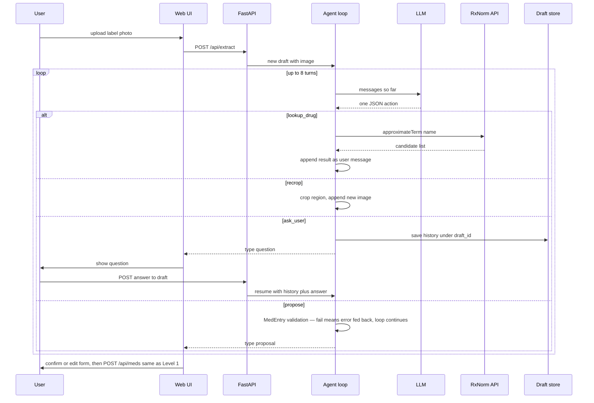

# Level 2 — The agent loop

## What's new

Extraction went from one LLM call to a **turn loop**. Each turn the model
returns one JSON action; the harness dispatches it and feeds the result back:

- `lookup_drug(name)` — verifies names against the RxNorm API (real drug DB)
- `recrop(top,left,bottom,right)` — crops a label region and re-shows it
- `ask_user(question)` — pauses the loop; the UI asks you; `resume_draft`
  continues with your answer appended to history
- `propose(...)` — terminal action; the proposal still must pass `MedEntry`

New modules: `app/agent.py` (loop + tools + draft store), `app/providers.py`
(provider-agnostic multi-turn chat — Level 1's one-shot `llm.py` stays for
comparison). UI gained a question card. Evals run the agent with
`allow_ask=False`.

## How it flows

## What I learned

1. **An agent is a loop, not a framework.** Message list + "model picks an
   action" + dispatcher + stop condition. ~150 lines. The complexity isn't
   the loop — it's everything the loop forces you to design.
2. **The action schema is your contract now.** In Level 1 the model emitted
   one shape; now it emits *control flow*. Every failure mode moved up a
   level: invalid JSON → reprompt, unknown action → reprompt, bad proposal →
   schema error fed back as a tool result. The model gets to fix its own
   mistakes — that's the point of the loop.
3. **Tools are just functions + honest descriptions.** `lookup_drug` is a
   10-line RxNorm call. What matters is the description telling the model
   *when* to use it — "use when the label is abbreviated or possibly
   misread." Tool docs are prompt engineering.
4. **ask_user inverted the ownership of waiting.** The agent can block on a
   human, which meant building draft sessions (`_drafts`) to persist the
   message history between HTTP requests. First taste of agent *state*.
5. **Stopping conditions are non-negotiable.** `MAX_TURNS = 8`. A 3B model
   will loop forever otherwise. Real agents need budgets: turns, tokens,
   time. Watching the loop is also where `confidence` showed its limits —
   the small model returned 0.95 confidence on a *blank* image. Confidence
   is another model output, not ground truth; the eval set is the check.
6. **Provider-agnostic paid off.** One `chat(messages)` seam; ollama, openai
   and anthropic all run the identical loop. The cost was a simple internal
   message format — cheaper than any provider SDK abstraction.

## How it maps to real products

This is the shape of every "AI agent" in production: a loop where the model
calls deterministic tools and a harness enforces contracts and budgets.
Claude Code, Cursor agents, customer-support bots — all are this pattern at
different tool counts. The human-pause (`ask_user` + drafts) is how every
approval-gated agent works: "the agent wants to run `rm -rf` — allow?"

## The seam it exposed → why Level 3 exists

The agent can now *act* but it can't *remember*. Ask it "did I take my pill
yesterday?" and there's nothing to reason over — `meds.json` holds state,
not history. Level 3 adds an event log (dose taken/missed, agent decisions)
plus summarization: memory that survives across sessions and shapes what
the agent says. Also still open: the loop's own behavior is unlogged —
Level 5 makes turns observable.
